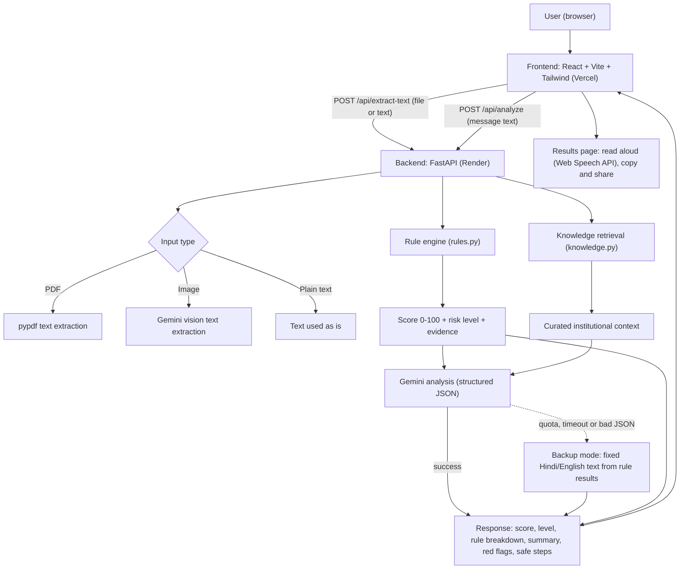
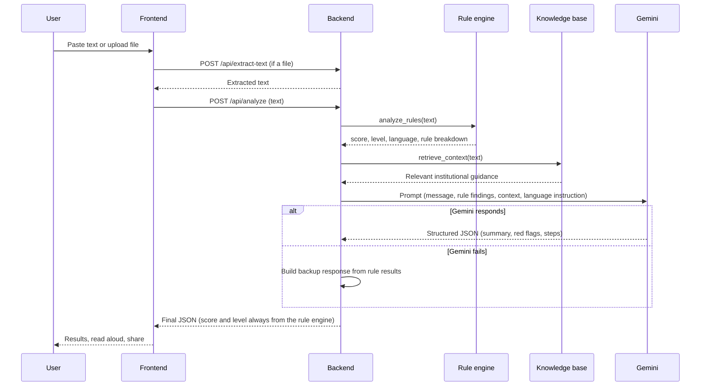
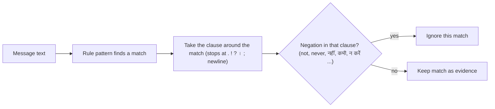

# RedFlagged: Technical Design Document

## 1. Purpose

RedFlagged helps people spot warning signs in suspicious messages (SMS, WhatsApp, email, PDFs, screenshots) that imitate banks, government departments, couriers, employers or payment services. It supports English and Hindi.

Design goals:

1. **Transparent scoring.** The risk score comes from deterministic rules that can be inspected, not from an AI's opinion.
2. **Useful explanations.** An AI model explains the findings in plain language, in the language of the message.
3. **Never fail silently.** If the AI is unavailable, the user still gets a score and safety steps.
4. **Safe by default.** The app gives verification guidance and never claims a message is legally genuine or fake.

Non-goals: legal advice, proving that a document is authentic, or detecting every possible scam.

## 2. System architecture



## 3. Request flow



## 4. Components

| Component | File | Responsibility |
|---|---|---|
| Frontend | `frontend/` | Input, results page, read aloud (Web Speech API), copy/share |
| API | `backend/main.py` | Routes, CORS, prompt building, Gemini call, backup mode |
| Rule engine | `backend/rules.py` | Deterministic detection, scoring, language detection, Hindi and English explanations |
| Knowledge base | `backend/knowledge.py`, `knowledge/` | Curated institutional guidance matched to the message |
| Tests | `backend/t.py` | 30 sample messages (Hindi, Hinglish, English) with expected risk levels |

## 5. Rule engine design

### 5.1 Rules and weights

| Rule | Points | What it looks for |
|---|---|---|
| Urgent deadline or coercion | 35 | Arrest, warrant, freeze, block, "within 2 hours", "तुरंत", "turant", and similar |
| Financial demand or digital payment | 35 | Pay/deposit/transfer words near an amount (₹, Rs, INR), UPI handles |
| Suspicious external link | 25 to 40 (highest finding) | Raw IP (35), link shortener (25), abuse-prone TLD (25), brand in an unrelated domain (40), lookalike domain by edit distance (35) |
| OTP, Aadhaar or credential request | 35 | OTP, PIN, password, Aadhaar, KYC and Hindi equivalents |
| Courier or customs hold scam | 30 | Customs or clearance fee, held parcel |
| Job or recruitment scam lure | 30 | Fees for jobs or internships, work-from-home offers, prize lures, Hindi equivalents |

### 5.2 Score and risk level

Triggered rules add up to raw points. A saturating curve turns them into a 0 to 100 score:

```
score = round(100 * (1 - e^(-raw_points / 38)))
```

| Raw points | Score | Level |
|---|---|---|
| 0 | 0 | LOW |
| 35 (one rule) | 60 | MEDIUM |
| 65 to 70 (two rules) | 82 to 84 | HIGH |
| 105 (three rules) | 94 | HIGH |

Thresholds: below 25 is LOW, 25 to 64 is MEDIUM, 65 and above is HIGH. The level is derived from the score, so the two always agree. Gemini does not change either value.

### 5.3 Matching and negation



Design decisions:

- **Hindi-safe word boundaries.** Python's `\b` does not treat Devanagari vowel signs as word characters, so patterns use explicit look-arounds instead. Without this, many Hindi rules would silently never match.
- **One negation check, limited to the same clause.** "Never share your OTP" and "बैंक कभी भी OTP नहीं मांगता" stay LOW, while a "do not" in a different sentence cannot cancel a real payment demand.
- **Generic words are not rules by themselves.** Words such as "अभी", "आज ही" or "साझा" only count when attached to an action (pay, send, share OTP), to avoid flagging everyday chat.

### 5.4 Language handling

`detect_language()` returns `hi` when more than 20 percent of the letters are Devanagari, otherwise `en`. The result drives:

- the language of the rule explanations and flags (`rule_hi` holds the Hindi rule name),
- the language instruction sent to Gemini,
- the language of the backup-mode text.

Roman-script Hindi (Hinglish) is detected by the rules but is treated as English for output.

## 6. AI analysis

Gemini receives the message, the rule findings, the detected language, retrieved institutional context and guidance not to treat well-known domains as suspicious by themselves. It must return JSON matching a fixed schema (`GeminiAnalysisResponse`). The backend takes the situation type, summary, red flags, safe steps, verification guidance and disclaimer from Gemini, and takes the **score and risk level from the rule engine**.

### Backup mode

If the Gemini call raises any error (quota exhausted, timeout, network error, invalid JSON), the backend returns HTTP 200 with the same response schema, built from the rule results: score, level, triggered rules with evidence, plus fixed safety steps, verification guidance and disclaimer in Hindi or English. An error response would also have no CORS headers, which browsers report as a CORS failure, so avoiding errors matters for the frontend too.

## 7. API contract

### `POST /api/extract-text`

Form fields: `file` (PDF or image) or `raw_text`. Returns `{"text": "..."}`. PDF text uses `pypdf`; images use Gemini vision.

### `POST /api/analyze`

Form field: `text`. Returns:

| Field | Description |
|---|---|
| `situation_type` | Short label of the scenario |
| `risk_level` | `LOW`, `MEDIUM` or `HIGH` (from the rule engine) |
| `calculated_score` | 0 to 100 (from the rule engine) |
| `rule_breakdown` | Six rows: `rule`, `points`, `triggered`, `explanation` (Hindi for Hindi messages) |
| `summary` | Plain-language assessment |
| `red_flags` | List of `indicator`, `evidence`, `explanation` |
| `safe_next_steps` | What the user should do |
| `verification_guidance` | How to verify through official channels |
| `disclaimer` | Not legal advice |
| `amounts`, `payment_handles`, `urgency_phrases`, `extracted_urls` | Extracted information |

## 8. Deployment and configuration

| Part | Platform | Configuration |
|---|---|---|
| Frontend | Vercel | `VITE_API_URL` points to the backend |
| Backend | Render | `GEMINI_API_KEY` (required), `GEMINI_MODEL` (optional) set as environment variables |

CORS allows only the deployed frontend and the local development origins (`localhost:5173`, `127.0.0.1:5173`). Secrets are kept in environment variables and `.env` files that are not committed; `.env.example` files document the names.

## 9. Security and privacy

- The API key stays on the server and never reaches the browser.
- Messages are sent to the Gemini API for analysis and are not stored by the application.
- The app does not follow or open links found in messages; it only analyses their structure.
- Output always includes a disclaimer, and verification advice points users to official channels they find themselves.

## 10. Limitations and trade-offs

- Rules only detect patterns that have been written; a scam with unfamiliar wording can score LOW. This is why the app gives guidance and not a verdict.
- Regular-expression rules can misfire on unusual phrasing. The sample test set guards against regressions but is not exhaustive.
- Free-tier Gemini quotas are limited, which is why backup mode exists. Backup explanations are generic.
- Hinglish explanations are produced in English; Gujarati is not supported.
- Reading aloud depends on voices installed on the user's device.

## 11. Testing

`backend/t.py` is a regression script with 30 invented messages: Hindi, Hinglish and English scams; genuine notices that must stay LOW; everyday messages that must not be flagged; and URL checks. For each message it prints the score, risk level, language and triggered rules, marks it `OK` or `FAIL` against the expected level, and ends with a `failures:` count that should be 0. Run it from the `backend` folder:

```bash
cd backend
python t.py
```

The script tests the rule engine only. It does not call Gemini, so it needs no API key and uses no quota. The sample messages are the test data; they are written directly in `t.py`.
